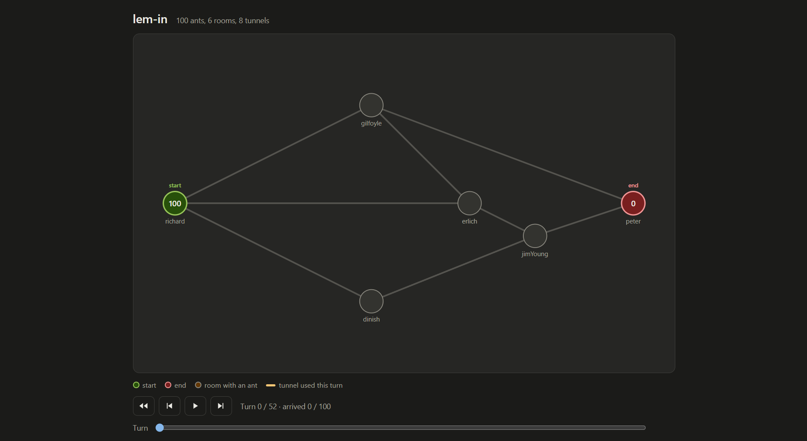
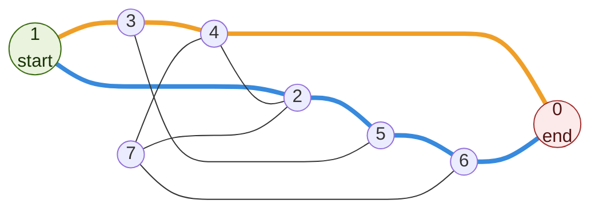
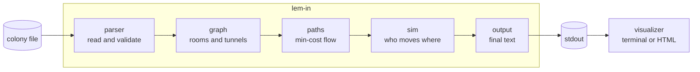

<h1 align="center">lem-in</h1>

<p align="center">
  Move a colony of ants through a maze of rooms and tunnels in the fewest possible turns.<br>
  Exact min-cost-flow solver, a built-in rule checker and an animated browser visualizer.<br>
  Go, standard library only.
</p>

<p align="center">
  
  
  
  
</p>

<p align="center">
  
</p>

[How it works](#how-it-works) · [Features](#features) · [Architecture](#architecture) · [Getting started](#getting-started) · [Usage](#usage) · [Testing](#testing) · [Team](#team)

---

## About

`lem-in` reads the description of an ant colony from a file: a number of ants, rooms with coordinates and the tunnels between them. All ants start in the `##start` room and must reach the `##end` room. Every turn each ant may move once, a room holds one ant at a time (start and end hold any number), and a tunnel can be used once per turn.

The program prints the file, an empty line, and then one line per turn. It does not print *a* good solution: the number of turns is the **minimum possible**, and the program can explain why.

It was built as a team project for the Zone01 Athens curriculum. The mandatory subject was extended with specific error messages, a test file for every package and a visualizer.

## How it works

One shortest path is not enough. The colony must be crossed by **several paths that share no room**, and the ants must be shared between them so that the last ant arrives as early as possible.

Take the colony of the subject's first example: 3 ants, 8 rooms.



The solver finds two room-disjoint paths: the orange one of length 3 (`1 → 3 → 4 → 0`) and the blue one of length 4 (`1 → 2 → 5 → 6 → 0`). Ants enter a path one per turn, so the greedy rule *"each ant takes the path where it arrives earliest"* sends ants 1 and 3 down the orange path and ant 2 down the blue one:

| Turn | Moves printed | Ant 1 | Ant 2 | Ant 3 |
|---:|---|:---:|:---:|:---:|
| 0 | | `1` | `1` | `1` |
| 1 | `L1-3 L2-2` | **3** | **2** | `1` |
| 2 | `L1-4 L2-5 L3-3` | **4** | **5** | **3** |
| 3 | `L1-0 L2-6 L3-4` | **0** | **6** | **4** |
| 4 | `L2-0 L3-0` | `0` | **0** | **0** |

The whole run takes **4 turns**. The best single path would need 5, so the second path is worth its extra length. With fewer ants it would not be: for a given number of paths `k`, the number of turns is

```
turns = ceil( (ants + L1 + L2 + … + Lk) / k ) − 1
```

so only the **sum of the path lengths** matters, and the solver keeps the `k` that minimises it for the number of ants it is given.

<details>
<summary><b>Why not just run a BFS?</b></summary>

On the audit's `example01` (10 ants) a single BFS shortest path needs 13 turns, and "BFS, remove the rooms used, BFS again" gives 9 or 13 depending on tie-breaks. The limit is 8. The shortest path goes through rooms that block every other route, so the optimal answer **does not contain the shortest path at all**: it uses three paths of length 5.

The solver therefore uses *successive shortest paths* (the idea behind Suurballe's algorithm) on a split-room network:

1. Every room except start and end becomes an `in` node and an `out` node joined by an arc of capacity 1. That arc enforces "one ant per room".
2. Every tunnel becomes two arcs of capacity 1 and cost 1.
3. Every arc gets a reverse arc of opposite cost. Travelling over a reverse arc **cancels** part of a path chosen earlier, so a later search can reroute an earlier path instead of being blocked by it.
4. Each round finds the cheapest route with a queue-based Bellman-Ford search and pushes one unit of flow along it. After round `k` the network holds the `k` room-disjoint paths of smallest total length.
5. The program keeps the `k` that gives the fewest turns for the number of ants.

The cost depends on the size of the colony and not on the number of ants.

</details>

## Features

- **Optimal turn count** on every colony, proved by the algorithm and checked by a rule checker in the tests
- **Strict input validation** with a specific message for each kind of mistake (see [Error messages](#error-messages))
- **Deterministic output**: the same file always gives the same text, byte for byte
- **Fast**: 1000 ants on the audit colony take about 5 ms, a generated colony of 3000 rooms and 9000 tunnels about 35 ms
- **Two visualizers**: an ANSI animation in the terminal, and a self-contained HTML page with play, pause, step and a slow-motion speed slider
- **Never crashes and never leaves half an output**: the result is built completely before anything is printed

### Visualizer

`./visualizer -html colony.html` writes one HTML file with the colony, the turns and the animation. It needs no server and no internet connection: open it in a browser.

- Walking SVG ants that face the direction of their move
- Play, pause, previous and next turn, restart, a turn scrubber and a speed slider from 0.1x to 4x
- Start and end rooms show how many ants they hold, the tunnels used in the current turn light up
- Keyboard shortcuts: `Space`, `←`, `→`, `Home`, `+`, `-`
- Light and dark mode

## Architecture



One sequential pipeline. Each package has one job, and only `main` prints.

| Package | Responsibility |
|---|---|
| `main.go` | Wiring and error messages. `run(args, w)` returns an error instead of printing it |
| `internal/graph` | The shared types (`Room`, `Colony`) and the adjacency of the graph |
| `internal/parser` | Reads the file with `bufio.Scanner`, validates it and returns exported error values |
| `internal/paths` | Builds the split-room network, runs the successive shortest paths, picks the best `k` |
| `internal/sim` | `Assign` (ants per path), `Run` (every turn) and `Check`, the rule checker used by the tests |
| `internal/output` | Turns the file lines and the turns into the final text |
| `internal/e2e` | End-to-end tests: build the real program, run it on `testdata/`, judge only what it prints |
| `cmd/visualizer` | Reads the output of `lem-in` on stdin and animates it in the terminal or as an HTML page |

## Engineering highlights

- **Exact, not "good enough".** The path sets come from min-cost flow, and the turn count of a set is plain arithmetic. There is no search over combinations, so the cost does not grow with the number of ants.
- **A checker that does not trust the solver.** `sim.Check` replays the printed turns against the rules: an ant uses an existing tunnel, no tunnel is used twice in a turn, no two ants end a turn in the same room, no ant moves twice, and all ants finish in the end room. Every end-to-end test passes its output through it.
- **No `os.Exit(1)`.** A non-zero exit makes `go run .` print an extra `exit status 1` line. The program prints one `ERROR:` line and returns normally.
- **No half results.** The output is built into one string first (`strings.Builder`, no `+=` in loops), so a failure never leaves part of a result behind.
- **Tests at four levels.** Table-driven unit tests per package, end-to-end tests of the built binary, a fuzz test of the parser (`FuzzParse`) and a stress test on a generated colony of 3000 rooms, 9000 tunnels and 1000 ants.
- **Tests that notice when they go stale.** The end-to-end tests build the program before running, and a test fails if a file in `testdata/` is not covered by any case.
- **A visualizer that cannot lie.** It replays the same turns the program printed. Bad moves (unknown ant or room) are reported by Go before the page is written, and room names are escaped, so a room called `</script>` cannot break the page.

### Results

Every audit example is solved within its limit.

| Colony | Ants | Turns | Audit limit |
|---|---:|---:|---:|
| subject example 1 | 3 | 4 | 4 |
| `example00` | 4 | 6 | 6 |
| `example01` | 10 | 8 | 8 |
| `example02` | 20 | 11 | 11 |
| `example03` | 4 | 6 | 6 |
| `example04` | 9 | 6 | 6 |
| `example05` | 9 | 8 | 8 |
| `example06` | 100 | 52 | time only |
| `example07` | 1000 | 502 | time only |

Run time of the built program, measured on the author's machine:

| Colony | Time |
|---|---:|
| `example06` (100 ants) | about 3.5 ms |
| `example07` (1000 ants) | about 4.5 ms |
| generated: 3000 rooms, 9000 tunnels, 1000 ants | about 35 ms |

## Getting started

### Prerequisites

- Go 1.22 or later
- A browser, only if you want the HTML visualizer

### Build

```bash
git clone https://github.com/nikospanagopoulos/lem-in.git
cd lem-in
go build -o lem-in .
go build -o visualizer ./cmd/visualizer
```

Run every command from the root of the repository. `go run . file.txt` works too, without building.

## Usage

```bash
./lem-in testdata/example00.txt
```

```
4
##start
0 0 3
2 2 5
3 4 0
##end
1 8 3
0-2
2-3
3-1

L1-2
L1-3 L2-2
L1-1 L2-3 L3-2
L2-1 L3-3 L4-2
L3-1 L4-3
L4-1
```

The output is the input file exactly as it was read (comments included), one empty line, and one line per turn. Each move `Lx-y` means that ant `x` enters room `y`. Moves are sorted by ant number, and only ants that moved appear.

### Visualizer

```bash
# animation in the terminal
./lem-in testdata/example06.txt | ./visualizer

# a page to open in a browser
./lem-in testdata/example06.txt | ./visualizer -html colony.html
```

| Flag | Default | Description |
|---|---|---|
| `-html FILE` | | Write an animated HTML page to `FILE` instead of drawing in the terminal |
| `-delay` | `500ms` | Pause between two frames in the terminal |
| `-width` | `78` | Width of the terminal drawing in characters |
| `-height` | `20` | Height of the terminal drawing in rows |
| `-color` | `true` | Use colours in the terminal |

To open the page from the terminal: `open colony.html` (macOS), `xdg-open colony.html` (Linux), `start colony.html` (Windows) or `explorer.exe colony.html` (WSL). Double-clicking the file works everywhere.

### Input format

| Line | Meaning |
|---|---|
| first line | Number of ants, an integer greater than 0 |
| `##start`, `##end` | The next room line is the start or the end room |
| `name x y` | A room: a name and two integer coordinates |
| `name1-name2` | A two-way tunnel |
| `#text` | A comment |
| `##text` | Any other command, ignored |

A room name cannot start with `L` or `#`, and cannot contain spaces or `-`. Rooms may appear before `##start`, and their order does not matter. Blank lines at the end of the file are ignored.

### Error messages

On bad input the program prints exactly one line and nothing else.

```
ERROR: invalid data format, <reason>
```

| Reason | Cause |
|---|---|
| `invalid number of Ants` | Missing, not an integer, zero, negative or too large |
| `no start room found` / `no end room found` | `##start` or `##end` missing, or not followed by a room |
| `duplicated start or end room` | Two `##start` or two `##end` |
| `duplicated room` | Two rooms with the same name |
| `invalid room name` | A name starting with `L` or `#`, or containing `-` |
| `invalid coordinates` | A coordinate is not an integer |
| `link to unknown room` | A tunnel names a room that does not exist |
| `room linked to itself` | A tunnel such as `3-3` |
| `duplicated link` | The same tunnel twice, in either direction |
| `invalid line` | A line that is not a room, tunnel, comment or command |
| `no path between start and end` | The colony has no route from start to end |
| `cannot read file` | Wrong number of arguments, or the file cannot be opened |

## Testing

```bash
gofmt -l .                  # prints nothing when the code is formatted
go vet ./...
go test ./...               # unit and end-to-end tests, plus the stress test
go test -short ./...        # the same, without the stress test
```

```bash
# fuzz the parser for 30 seconds
go test -fuzz=FuzzParse -fuzztime=30s ./internal/parser

# time the built program on example06, example07 and the stress colony
go test -bench=Program -run '^$' ./internal/e2e
```

The input files live in [`testdata/`](testdata), with a [README](testdata/README.md) that shows every colony as a small drawing: the eight audit examples, the two bad audit examples and 15 cases of our own (comments, rooms before `##start`, Windows line endings, a path that looks shortest but is not, and every error of the table above).

## Project structure

```
lem-in/
├── main.go                 # wiring and error messages
├── check.sh                # runs the project checks (format, vet, tests)
├── go.mod                  # module lem-in, no dependencies
├── cmd/
│   └── visualizer/
│       ├── main.go         # flags and the terminal animation loop
│       ├── input.go        # reads the output of lem-in
│       ├── state.go        # where every ant is, turn by turn
│       ├── layout.go       # room coordinates to terminal cells
│       ├── draw.go         # draws tunnels, rooms and ants
│       ├── web.go          # writes the HTML page (go:embed)
│       ├── web/
│       │   ├── index.html  # page template
│       │   ├── app.js      # animation: play, pause, step, speed
│       │   └── style.css
│       └── *_test.go
├── internal/
│   ├── graph/              # shared types and adjacency
│   ├── parser/             # reading and validation, error values
│   ├── paths/              # network, min-cost flow, best set of paths
│   ├── sim/                # ants per path, turns, rule checker
│   ├── output/             # final text
│   └── e2e/                # end-to-end, stress test and benchmark
├── testdata/               # audit examples and our own cases, with a README
├── docs/
│   ├── images/             # screenshots used by this README
│   ├── prd.md              # product requirements
│   └── task_cards.md       # task breakdown
└── README.md
```

The requirements and the task breakdown are in [`docs/prd.md`](docs/prd.md) and [`docs/task_cards.md`](docs/task_cards.md).

## Known limitations

- A room name cannot contain `-`, because a tunnel line is split on its single `-`.
- The terminal visualizer draws straight tunnels on a character grid, so tunnels that cross are marked with a `+`. The HTML page has no such limit.
- The HTML page replays the turns the solver printed. It does not solve anything itself.

## Team

A Zone01 Athens team project.

| Zone01 login | GitHub | Focus |
|---|---|---|
| **npanagopoul** | [nikospanagopoulos (Nikolaos Panagopoulos)](https://github.com/nikospanagopoulos) | `sim`, `output`, `main`, test data, end-to-end, fuzz and stress tests, terminal and HTML visualizer |
| **dsakkas** | [dimsakkas](https://github.com/dimsakkas) | `paths`: split-room network, min-cost flow, choice of the best path set |
| **dpavaloa** | [Mimispavo (Dimitris-Victor Pavaloaia)](https://github.com/Mimispavo) | `graph` and `parser`: shared types, input validation, error values |

Documentation was written by the whole team.

## Acknowledgements

- The *lem-in* subject, provided by Zone01 / 01 Edu
- The idea of successive shortest paths follows Suurballe's algorithm for disjoint paths